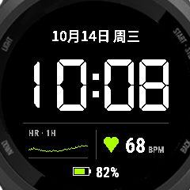

# LCD HR 245

为 Garmin Forerunner 245 和 245 Music 设计的 Connect IQ 表盘。主屏以白色七段数字显示 24 小时时间，顶部显示中文日期。下方的绿色曲线展示最近一小时的心率走势，右侧显示当前心率，底部显示剩余电量。



## 安装 v1.0.8

1. [下载最终版 USB 安装包](https://github.com/cfmcgrady/garmin-lcd-watchface/raw/refs/tags/v1.0.8/dist/FR245-LCD-HR-v1.0.8-USB.zip)，在电脑上解压。
2. 用支持数据传输的 USB 线连接手表，把 `LcdHr245.prg` 复制到手表的 `GARMIN/APPS/` 目录。
3. 安全弹出手表并断开 USB，在手表上长按 **UP**，进入 **表盘**，选择 **LCD HR 245** 并应用。

安装包内的 `LcdHr245.prg` 是原版签名程序，共 16,348 字节。其 SHA-256 为 `20e5818e7dbbc78b62879b70b7b26b7fddea7281e1451d61a32813b47ce6cace`。

## 心率与刷新

左侧曲线显示最近一小时的历史心率，每分钟内的采样取平均值，遇到无效读数或过长的采样间隔时会断开曲线。表盘每五分钟读取一次整段历史。右侧优先显示当前心率，平时每分钟更新，抬腕可触发额外更新，额外读取有 15 秒的间隔限制。只有历史读数可用时，最多沿用最近三分钟内的有效值，之后显示 `--`。

v1.0.8 在可用内存充足时缓存已绘制的画面。实机续航改善尚未测量。

## 构建与验证

本仓库提供 v1.0.8 的重建源码。恢复工作以早期原始工程为基础，对照最终版的布局、刷新逻辑、测试记录和已签名安装程序完成。

使用 Connect IQ SDK 9.2.0 为 `fr245` 和 `fr245m` 分别编译后，两份程序的全部非签名区段均与原版逐字节相同，包括 Monkey C 字节码、字体和图像。重建时使用了新的测试签名密钥。Forerunner 245 模拟器的 13 项测试全部通过，时间布局检查覆盖全天 1,440 个时刻。

安装 Garmin Connect IQ SDK，并用 SDK Manager 下载 `fr245` 或 `fr245m` 的设备支持文件。用自己的 Connect IQ 开发者签名密钥编译。以下命令以 Forerunner 245 为例。

```sh
python3 tools/build.py --sdk /path/to/connectiq-sdk --key /path/to/developer.der --device fr245
```

默认输出为 `build/LcdHr245.prg`。245 Music 使用 `--device fr245m`，输出为 `build/LcdHr245Music.prg`。项目内已包含位图字体；只有重新生成字形才需要运行 `tools/make_assets.py`，它使用 Pillow、系统字体 Noto Sans CJK Bold、DejaVu Sans Condensed Bold 以及仓库中的 DSEG 和 Roboto Condensed。

编译模拟器测试时，在构建命令后增加 `--tests`。启动 Connect IQ Simulator，再用 SDK 的 `monkeydo` 运行测试。时间布局检查需要 Python 和 Pillow。

```sh
monkeydo build/LcdHr245Tests.prg fr245 -t
python3 tools/check_time_layout.py
```

## 许可证

项目原创代码采用 [Apache License 2.0](LICENSE)。[字体与图标的来源及许可](licenses/README.md)
